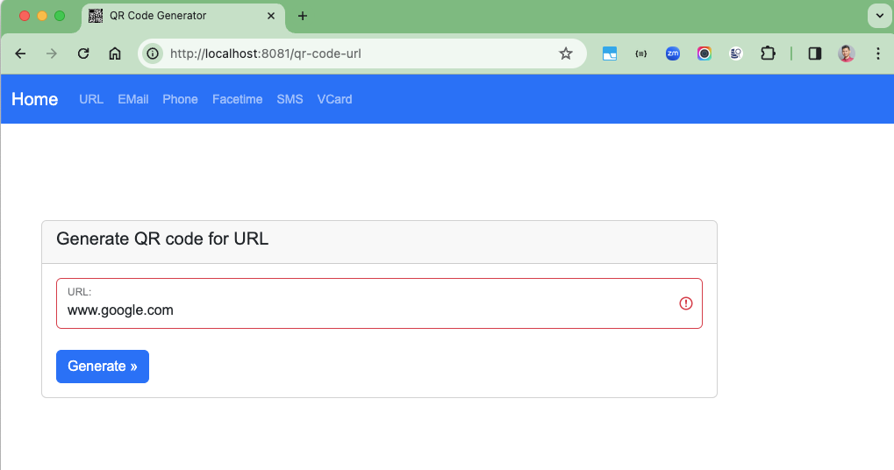
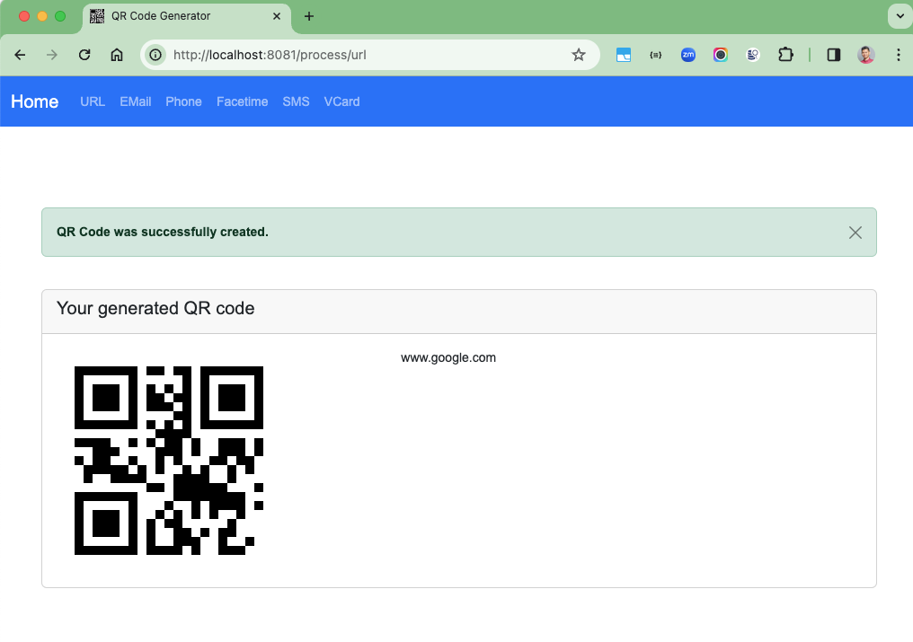
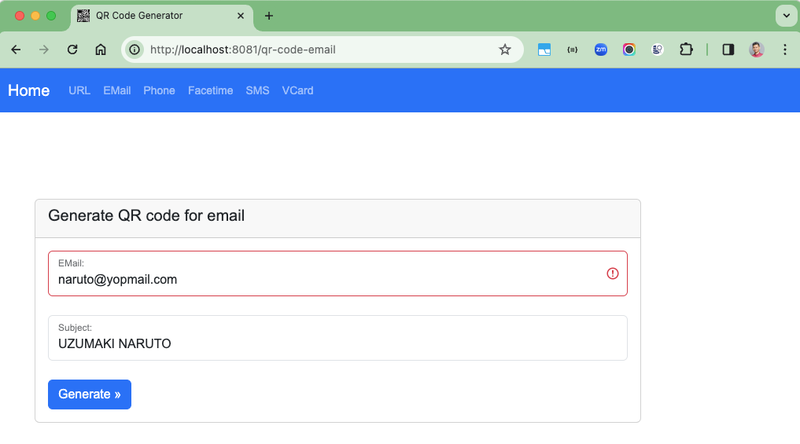
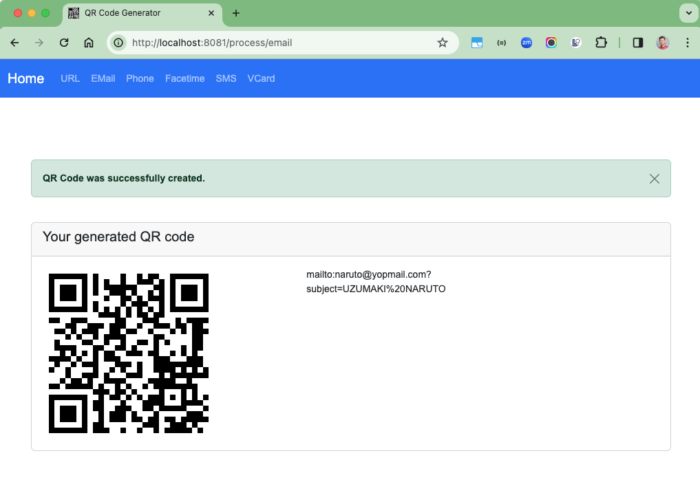
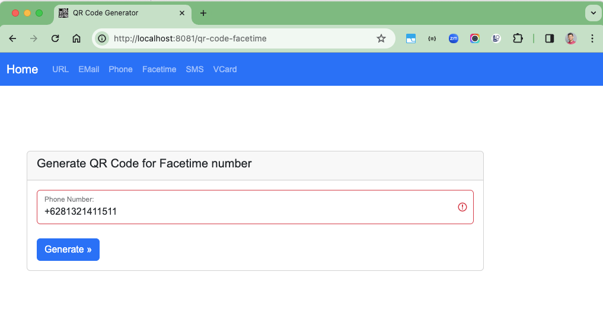
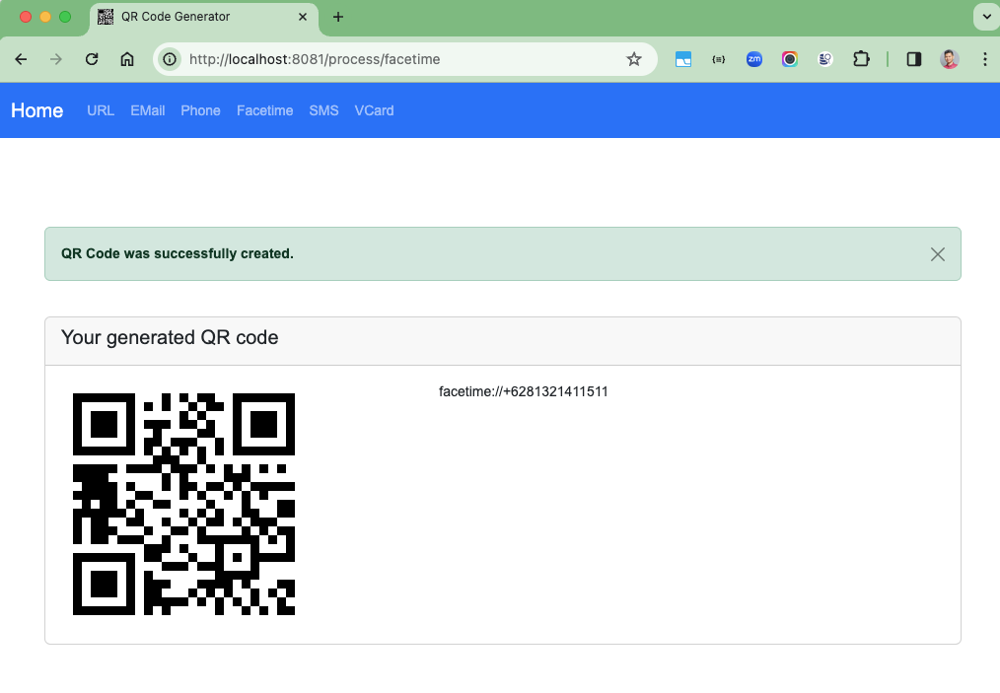
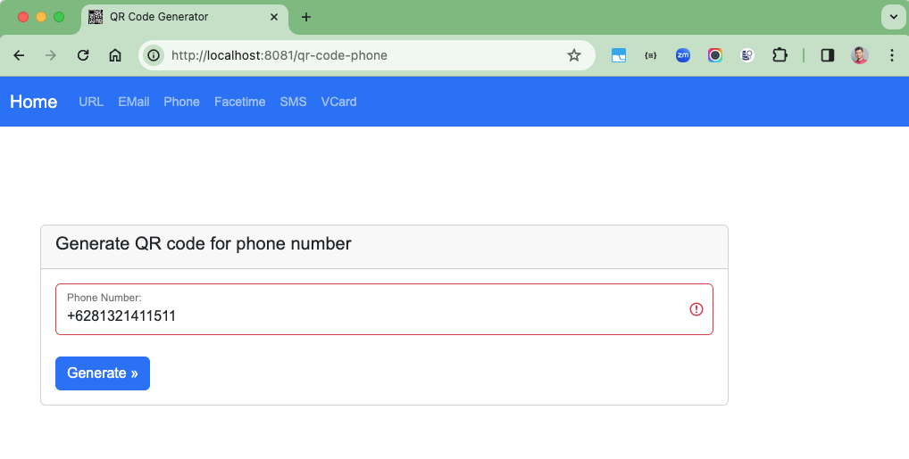
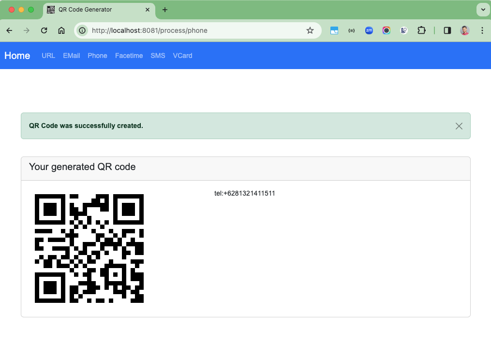
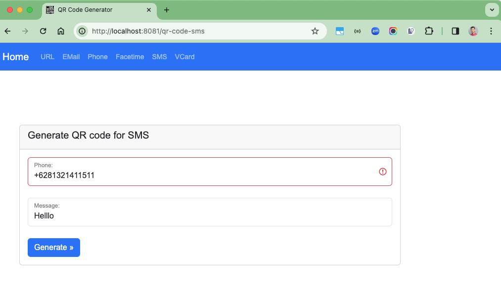
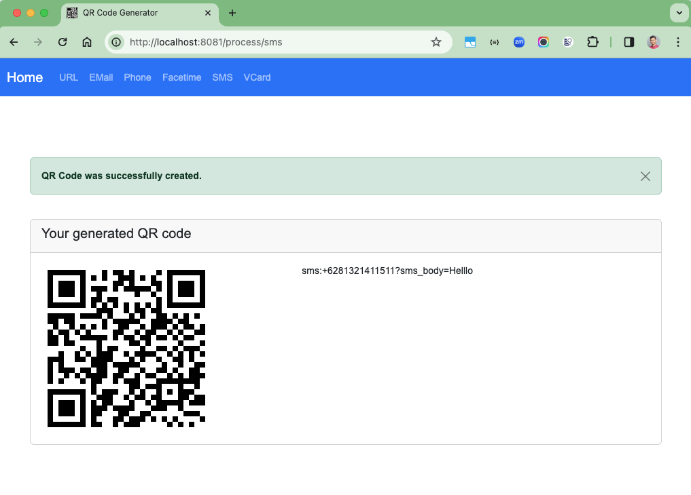

# spring-boot-qrcode-generator

[](https://github.com/hendisantika/spring-boot-qrcode-generator/actions/workflows/main.yml)


A simple web application to generate (and decode) QR Codes built with Spring Boot, Thymeleaf and
[ZXing](https://github.com/zxing/zxing).

Supported QR Code types:

- URL
- Email (with subject & body)
- SMS
- Phone number
- FaceTime
- Event (calendar)
- vCard (contact)

## Tech Stack

| Component   | Version                     |
|-------------|-----------------------------|
| Java        | 25 (LTS)                    |
| Spring Boot | 4.1.x                       |
| Thymeleaf   | managed by Spring Boot      |
| ZXing       | 3.5.x                       |
| Bootstrap   | 5.3.x (WebJars)             |
| Lombok      | managed by Spring Boot      |
| Build tool  | Maven (Maven Wrapper incl.) |

## Prerequisites

- JDK **25**
- Maven 3.9+ (optional, the project ships with Maven Wrapper `./mvnw`)
- Docker (optional)

## Things todo

1. Clone the repository: `git clone https://github.com/hendisantika/spring-boot-qrcode-generator.git`
2. Navigate to the folder: `cd spring-boot-qrcode-generator`
3. Run the application: `./mvnw clean spring-boot:run`
4. Open your favorite browser: http://localhost:8083

### Run the tests

```shell
./mvnw clean verify
```

## Docker Way

The `Dockerfile` uses a multi-stage build (`maven:3.9-eclipse-temurin-25-alpine` → `amazoncorretto:25-alpine-jdk`)
and runs the app as a non-root user, so you don't need to package the app first.

Build Docker image

```shell
docker build -t hendisantika/qrcode-generator:latest .
```

Run Docker Image

```shell
docker run -it --rm -p 8083:8083 --name qrcode-generator hendisantika/qrcode-generator:latest
```

Push Docker image to Docker Hub

```shell
docker push hendisantika/qrcode-generator:latest
```

## CI/CD

GitHub Actions workflow ([`.github/workflows/main.yml`](.github/workflows/main.yml)):

1. **Build & Test** — sets up JDK 25 (Amazon Corretto) with Maven cache and runs `./mvnw clean verify` on every push &
   pull request to `main`. Test reports are uploaded as artifacts.
2. **Build & Push Docker Image** — on push to `main`, builds the image with Buildx and pushes
   `hendisantika/qrcode-generator:<run_number>` and `:latest` to Docker Hub.
3. **Deploy** — copies the `.env` file to the server and runs [`deploy.sh`](deploy.sh) over SSH.

Required repository secrets: `DOCKERHUB_USERNAME`, `DOCKERHUB_TOKEN`, `SERVER_HOST`, `SERVER_PORT`, `SERVER_USERNAME`,
`SERVER_KEY`, and variable `APP_SERVER_PORT_DEV`.

## Dependency Updates

[Dependabot](.github/dependabot.yml) keeps dependencies up to date:

| Ecosystem      | Schedule        | Notes                                                                    |
|----------------|-----------------|--------------------------------------------------------------------------|
| Maven          | daily (05:00)   | grouped: Spring Boot, ZXing, WebJars, Apache Commons, Maven plugins      |
| GitHub Actions | weekly (Monday) | all actions grouped in a single PR                                       |
| Docker         | weekly (Monday) | base images; major JDK upgrades are done manually                        |

## Images Screenshot

Home Page


QRCode





Email





Facetime





Phone Number





SMS




